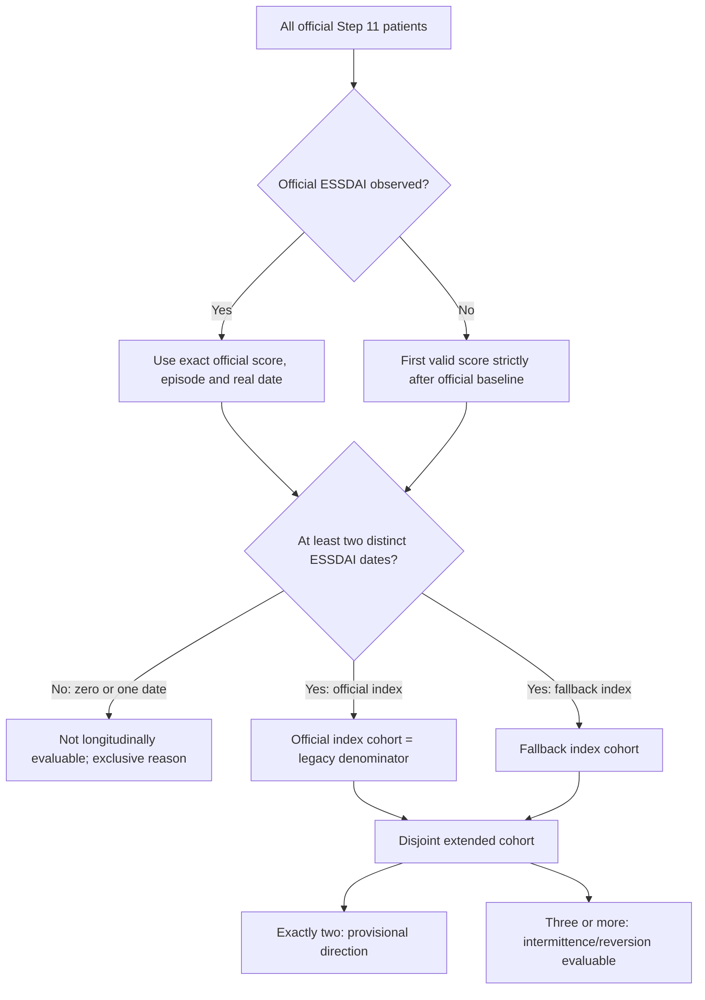

# Step 13: observed ESSDAI patterns v2

## Scope and audit

Implementation base: live `main` **e96f18955cc5d41208fdb3aa66122b20f25a249a**,
confirmed through the connected GitHub API on 2026-10-20. The local cached
`origin/main` was stale (`de835fb`); the clean `work` branch matched live main.
Implementation branch: `codex/step13-observed-patterns-v2`.
Initial shell Git access could not reach the proxy; enabling network access
for the Git command resolved it. `git ls-remote` independently confirmed the
same live main SHA before publication.

**CONDITIONAL — real-cohort validation pending.**
**NOT RUN — canonical inputs unavailable.** Neither canonical Step 10 nor
Step 11 Parquet is present; generated Step 13 v1/14 reference products and
manifests are also absent. Input hashes and historical product comparisons
are unavailable, not zero. No cohort count in this document is a clinical result.
The previous standalone `instrucciones_agente_step13_step14_explain_why.md`
was not available; the existing v1 module, tests and `13_14_explain_why_*`
protocol/implementation documents were reviewed. This extension changes only
the v2 eligibility/index and observed-pattern specification.

| Real-input audit | Result |
| --- | --- |
| N Step 11; baseline ESSDAI observed/missing | NOT RUN — canonical inputs unavailable |
| N official index cohort | NOT RUN — canonical inputs unavailable |
| N fallback candidates; 0/1/2/3/4+ dated scores | NOT RUN — canonical inputs unavailable |
| N eligible fallback; N extended | NOT RUN — canonical inputs unavailable |
| Exclusive exclusion reasons and entry-delay quantiles | NOT RUN — canonical inputs unavailable |
| Historical v1 products/hashes and clinical review | Unavailable / pending |

Reported reference counts (159, 143, 62 and 16) are not constants, inferred
exclusions, expected cohort sizes or acceptance targets.

## Execution and compatibility

Use the repository Python environment, after producing canonical Steps 10/11:

```bash
python src/block_A/13_disease_activity_progression.py --observed-patterns-v2 --dry-run
python src/block_A/13_disease_activity_progression.py --observed-patterns-v2 --no-overwrite
# A deliberate rerun backs up the previous v2 bundle:
python src/block_A/13_disease_activity_progression.py --observed-patterns-v2 --overwrite
```

The dedicated flag runs **only** the v2 writer before the legacy entrypoint
creates any directory or fits any model. Standard Step 13 invocation is unchanged.
Use `--integrated`, `--baseline`, `--output-root` for authorized alternate storage;
use `--input-origin synthetic_validation` for fixtures. CSV input is accepted
through the existing reader, with strict raw date/score validation before legacy
coercion. Missing inputs stop explicitly without a final bundle. The 12 upstream
ordinal-domain contract is checked; no domain or total is derived.

`--dry-run` computes both definitions of date sensitivity, bridge and blocking QC
without any file writes, even when `--no-overwrite` finds an existing bundle.
`--no-overwrite` rejects existing v2 products before mutation. Overwrite copies
only v2 products to `outputs/backups/13_disease_activity_progression/v2_<UTC>/`,
retaining relative paths. All products are staged after QC; exceptions during
staging leave prior products untouched. Installation errors roll back replaced
files; the new manifest is installed last. This provides exception rollback,
not a guarantee of filesystem-wide atomicity across process/host crashes.
A consumer must verify every artifact hash against the manifest before use.

| Contract | v1 / legacy (unchanged) | Opt-in v2 |
| --- | --- | --- |
| Clinical baseline | Official Step 11 | Same official episode/date |
| ESSDAI reference | Official baseline score required | Official score, or first strictly later valid dated score |
| Longitudinal direction | Ever/last endpoints already permit 2 dates | Four-pattern classification from 2 dates; provisional |
| Shape support | v1 patterns need 3 distinct dates | Intermittence needs 3; other patterns need 2 |
| Worsening/improvement labels | `worsening_threshold_observed_no_reversion` / `improvement_threshold_observed_no_reversion` | `worsening_observed` / `improvement_observed` |
| No longitudinal evidence | v1 includes insufficient in its pattern summary | Separate eligibility status, outside four clinical classes |
| Step 14 | Official baseline, existing risk sets and +5 sensitivity | No automatic exposure, event or cohort change |

The v1 module, Step 10/11/12, config and Step 14 are untouched. All Step 13
functions except CLI `parse_args`/`main` retain their original AST. No episode,
ESSDAI, ESSPRI, Pop, model, FDR family or original output is reconstructed.
Retrospective complete-history labels must never be baseline/FROM predictors.

## Two clocks, cohort flow and dates



`official_clinical_baseline_date` and `official_baseline_episode_id` come from
Step 11 and must agree with Step 10. Official baseline time remains zero.
`essdai_index_date` and `time_since_essdai_index_years` belong only to separate
v2 products. First later ESSDAI is an observation index, not a replacement
clinical baseline or disease onset.

Rows missing ESSDAI remain in the source, with histories, labs, PROs and treatment
columns unchanged. They do not contribute score dates. Undated score episodes
are excluded from the score sequence and counted explicitly; nominal calendar
information is never substituted. A patient missing a reliable clinical baseline
date is not evaluable. A malformed supplied date, invalid/out-of-range score,
negative/conflicting recorded clinical time, duplicate key, nonunique baseline
or Step 10/11 disagreement blocks the bundle. Same-date intervals are allowed
as tied records; a longitudinally eligible selected sequence must span positive
time between distinct dates. Times use actual days / 365.25.

Sort by real date and canonical episode ID, stably. Select the last valid
canonical episode per follow-up date. The official score has priority over all
same-day companions, which never become follow-up or a fallback index. Missing
official ESSDAI requires a date strictly after baseline, even if a companion
on the baseline date has a score. No score before official baseline/index enters
the sequence. Baseline companion counts and every discordant date are audited.

The sensitivity excludes each **entire** date with differing valid scores.
If the official index date is discordant, that subject becomes insufficient
with `discordant_official_index_date`; it never receives a substitute official
score. For fallback, reselect the first remaining strictly later score and
recompute support/index-relative deltas, explicitly under the sensitivity flag.
This is a different sensitivity index and can change eligibility; it does not
alter the primary cohort. Sensitivity tables retain the full subject audit,
including newly insufficient subjects.

## Formal assignment and examples

For distinct observed dates t0 < t1 < … < tm, scores E0,…,Em and k ∈ {3,5},
set Δj=Ej−E0 for j>0. `up_j = Δj >= k`, `down_j = Δj <= -k`.
`ever_up` and `ever_down` are any qualifying follow-up observation.
`up_reversion` means some **later follow-up date** no longer satisfies a
previously observed up threshold; down reversion is analogous. The index itself
is never the later observation documenting reversion.

Assignment precedence:

1. Fewer than 2 dates: `insufficient_observations` (eligibility only).
2. At least 3 dates and both directions or either reversion: `intermittent_observed`.
3. Otherwise any up: `worsening_observed`.
4. Otherwise any down: `improvement_observed`.
5. Otherwise: `within_threshold_observed` (display: Stable / within threshold).

Monotonicity is not required. Exactly 2 dates receive
`two_points_direction_only` and `intermittence_evaluable=false`; 3+ receive
`three_or_more_points_pattern` and `intermittence_evaluable=true`; 0–1 receive
`insufficient`. Absence of an intermittent label with only two points cannot
establish absence of clinical intermittence.

| Synthetic scores (±3) | Pattern | Evidence |
| --- | --- | --- |
| [2] | insufficient_observations | insufficient |
| [2,2] | within_threshold_observed | two_points_direction_only |
| [2,4] | within_threshold_observed | two_points_direction_only |
| [2,5] | worsening_observed | two_points_direction_only |
| [8,5] | improvement_observed | two_points_direction_only |
| [2,5,7] | worsening_observed | three_or_more_points_pattern |
| [8,5,3] | improvement_observed | three_or_more_points_pattern |
| [2,6,2] | intermittent_observed | three_or_more_points_pattern |
| [8,3,8] | intermittent_observed | three_or_more_points_pattern |
| [4,8,1] | intermittent_observed | three_or_more_points_pattern |
| [2,4,3] | within_threshold_observed | three_or_more_points_pattern |
| [2,6,5] | worsening_observed | three_or_more_points_pattern |

Tests repeat inclusive boundaries at ±5, zero, floors/ceilings, ties and
reversions. Direction changes ignore zero successive differences. Threshold
crossings count entry and exit across each boundary, starting inside the band;
a direct +k to −k crosses two boundary indicators. Neither descriptor alone
proves intermittence. Event flags at k=5 must nest within k=3 for the same index;
pattern labels need not nest.

## Protected patient dictionary

One eligible row per `patient_id × threshold_abs` goes into the patient pattern
Parquet. The complete Step 11 attrition audit retains the same two threshold
rows per subject, including insufficient. Selected score dates are a separate
protected sequence, with no changes to source visits.

| Fields | Meaning |
| --- | --- |
| `patient_id`, `threshold_abs`, `definition_version` | Internal subject key, k=3/5, `observed-essdai-pattern-v2` |
| `date_policy`, `sensitivity_flag` | Last canonical episode per date; primary or exclude-entire-discordant-dates |
| `official_baseline_episode_id`, `official_clinical_baseline_date` | Immutable Step 11 baseline identity/date |
| `official_baseline_essdai_available` | Official episode's score availability |
| `essdai_index_source` | Official score policy or first observed after official baseline; in insufficient rows this is the intended selection route, not evidence an index exists |
| `essdai_index_episode_id`, `essdai_index_date`, `essdai_index_score` | Actual selected index; missing when none is reliable |
| `days_from_clinical_baseline_to_essdai_index` | Observed entry delay; zero official, positive fallback, missing without index |
| `n_distinct_essdai_dates`, `n_essdai_followup_dates` | Selected date count including index; strictly later selected dates |
| `n_canonical_essdai_episodes`, `n_same_date_extra_episodes` | All valid dated episodes on/after official baseline before sensitivity; episodes minus distinct dates, including baseline companions |
| `n_discordant_essdai_dates`, `n_excluded_discordant_dates` | Candidate dates with differing scores; whole dates removed in sensitivity |
| `n_undated_essdai_episodes`, `n_missing_essdai_episodes`, `n_prebaseline_essdai_episodes` | Excluded-score/history audit counts |
| `n_official_baseline_same_date_companions` | All other clinical episodes on official baseline date |
| `followup_years_from_essdai_index`, `assessment_frequency_per_year` | Selected last−index span; follow-up dates/span (missing without positive span) |
| `baseline_state_official`, `index_activity_state` | Low <5, Moderate 5–<14, High ≥14; Missing retained separately |
| `baseline_pop_official` | Verified published Pop1/2/3 only, otherwise Unclassifiable; never inferred from fallback ESSDAI/ESSPRI |
| `cohort`, `eligibility_status`, `exclusion_reason` | Official/fallback eligible cohort or not longitudinally evaluable; exclusive reason |
| `observed_pattern`, `trajectory_evidence_level`, `intermittence_evaluable` | Four labels/insufficient and explicit observation support |
| `observed_change_direction_last`, `last_up`, `last_down` | Selected final delta direction; not_evaluable when no follow-up |
| `ever_up`, `ever_down`, `up_reversion`, `down_reversion` | Nonexclusive excursion/reversion flags |
| `first_observed_up_date`, `first_observed_down_date` | First selected-date excursion; NaT if never observed |
| `max_delta_from_essdai_index`, `min_delta_from_essdai_index`, `last_delta_from_essdai_index` | Follow-up-only delta extrema/final delta; missing with no follow-up |
| `n_direction_changes`, `n_threshold_crossings` | Complementary observed sequence descriptors |
| Selected-date `time_since_essdai_index_years` | Actual days from that selected index /365.25, distinct from official baseline time |

Exclusion reasons: `no_valid_essdai_dates`, `only_one_valid_essdai_date`,
`unreliable_clinical_baseline_date`, and sensitivity-only
`discordant_official_index_date`. Undated episodes are separately counted and
never inserted into an otherwise reliably dated sequence.

## Products and denominators

All filenames below start with `13_essdai_`; all are v2-only. Directories use
`13_disease_activity_progression` under the existing area/stem structure.

| Area | Suffixes (with extension) |
| --- | --- |
| `data/analytic/blockA/` (protected) | `patient_observed_patterns_v2.parquet`, `pattern_patient_eligibility_v2.parquet`, `pattern_selected_dates_v2.parquet` |
| `outputs/tables/blockA/` (controlled aggregate) | `pattern_eligibility_v2.csv`, `observed_pattern_summary_v2.csv`, `pattern_by_index_source_v2.csv`, `pattern_by_index_state_v2.csv`, `pattern_by_baseline_state_v2.csv`, `pattern_by_pop_v2.csv`, `pattern_followup_sensitivity_v2.csv`, `pattern_legacy_bridge_v2.csv` |
| `outputs/qc/blockA/` | `observed_pattern_qc_v2.csv`, `observed_pattern_manifest_v2.json` |
| `outputs/figures/blockA/` | `observed_pattern_aggregate_v2.pdf` |

Eligibility reports all Step 11 subjects, source route, baseline score availability,
exclusive exclusion reasons, ≥1/≥2/≥3/≥4 dates, exactly two dates and fallback
entry-delay min/quartiles/median/max in days. The union of eligible official and
fallback cohorts is disjoint. No fixed numerical cohort targets are imposed.

The summary has exactly four rows per threshold/stratum, including empty classes.
It reports `n_total_step11`, local Step 11 N, eligible official/fallback/extended
N, exactly two, three or more, insufficient, and evidence-specific pattern counts.
`denominator_primary` for intermittence is **N with ≥3 dates**; its
`pct_of_extended` additionally reports the proportion over all ≥2-date patients.
Other pattern percentages use ≥2 dates. Primary percentages across the four
labels therefore do not add to 100%; `pct_of_extended` does. Empty denominators
produce missing percentages, never fabricated zero precision.

`pattern_by_baseline_state` explicitly separates Missing from known official
Low/Moderate/High; fallback state belongs only to `pattern_by_index_state`.
Pop remains official and Unclassifiable is visible even when Pop is absent.
Source-index proportions are descriptive and are not comparable risk estimates.
Sensitivity tables distinguish exactly two, ≥3, ≥4 dates; duration <2, 2–<5,
≥5 years; follow-up assessment frequency <1/≥1 per year; and whole discordant-date
exclusion. Their local eligibility/official counts describe the sensitivity
subset, not a change to the primary legacy cohort. The legacy bridge has
aggregate definition cross-tabs and official endpoint discrepancies, separating
discordant ties from unexplained differences. With no discordance, all ever/last
flags and the official denominator must match the unchanged legacy builder.

The PDF separates insufficient eligibility from clinical classes and stacks
provisional two-date support versus ≥3-date support, with count/denominator and
percentage annotations for both thresholds. It contains no individual trajectory.

## QC, provenance, privacy and closure

Blocking QC enforces unique/complete patient-threshold keys, correct labels and
evidence, observed reversions on distinct later dates, valid index identity,
positive longitudinal spans, no inferred fallback Pop, disjoint cohorts, nested
threshold events, deterministic date/score/Pop reconstruction, selected-date
uniqueness and legacy reconciliation outside audited discordance. Strict input
validation additionally enforces official baseline identity/date/score/Pop
agreement and real-time consistency. Tests verify no mutation, missing clinical
visit preservation, controls against partial bundles, backups and hashes.

The manifest records input file SHA-256 when supplied by the CLI, input frame
hashes, code commit and source/config SHA-256, every artifact hash, pre-existing
legacy product hashes, input origin, date/index/tie rules, pending review and
closing criteria. Dirty-source runs are identifiable by source hashes even if
the code commit predates the edit. The manifest has no patient records.

Products stay in controlled storage. No output is a public export or permission
to publish. Tables have no patient IDs or individual dates, but sparse cells
and entry-delay summaries still require institutional disclosure review before
sharing externally. No real input, row-level product or generated clinical
result is committed to Git. The writer performs no external publication.

Two dates cannot establish intermittence. Sparse assessments do not show
continuity, persistent disease, remission, treatment response or recurrent flares.
Observed threshold proportions are neither causal effects, fixed-horizon risks
nor annual incidence. Review late entry, duration/frequency differences,
informative missingness, measurement variation, regression to the mean,
floor/ceiling and treatment confounding. Missing official ESSDAI is not evidence
of absent disease. Any future Step 14 fallback analysis needs its own estimand,
origin, risk sets and temporally documented predictors; it is outside this change.

See `13_essdai_observed_patterns_v2_validation.json` for exact software checks,
pre-existing failure reproduction and run evidence. Clinical closure requires
an authorized real-input run, reviewed hashes/cohort reconciliation, blocking QC
PASS, clinical review and institutional disclosure review. Synthetic software
PASS cannot close those criteria.
