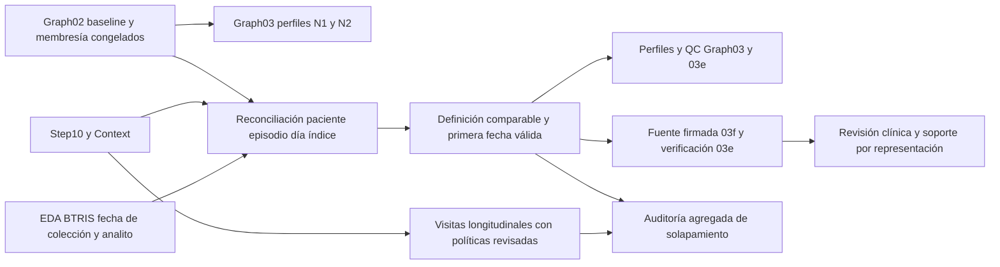

# Fuentes, linaje y elegibilidad de Graph03

## Identidad, fecha y resultado

- La reconciliación exige el paciente del release y el episodio índice y día concordantes con Step10. Un episodio fuente ambiguo, no verificable o atribuido a otro paciente queda fuera. Un paciente inequívoco puede tener un resultado con fecha verificable y episodio fuente desconocido. La sensibilidad de vínculo exacto exige ambos identificadores.
- Se conserva el identificador original y la distinción entre nombre del cluster y de la observación. Una colección corroborada usa BTRIS raw, intermedio o un campo de espécimen con procedencia original documentada. Las fechas ambiguas o discordantes se excluyen. La fecha solo EDA sirve para sensibilidad. El adaptador Step01/Context produce evidencia candidata de la fecha seleccionada por episodio. Su salida nunca acredita la colección, el ensayo o el espécimen.
- Las definiciones conservan el nombre original de orden, cluster, observación, ensayo y unidad. El identificador de definición es el hash de esa tupla. RF conserva cada unidad original sin conversión. El selector excluye valores censurados, administrativos, no interpretables o con mapeo no verificado. Una ausencia no equivale a una prueba negativa.
- La definición primaria se elige por cobertura de pacientes en el conjunto congelado, con desempate determinista por definición y con procedencia original. La selección es común a todas las comunidades y representaciones. Entre los valores comparables se usa el primer día válido. Se colapsan los duplicados. Valores discordantes o unidades incompatibles del mismo ensayo en ese día bloquean al paciente para esa definición con `AMBIGUOUS_EARLIEST_DAY`. Las alternativas se reportan con su propia definición y soporte.
- ANA, ANA HEp-2, RF cuantitativo, RF cualitativo y proteinuria cualitativa conservan sus codificaciones. RF cuantitativo tiene prioridad si resulta estimable. Las dos codificaciones de RF comparten una familia y no aportan dos pruebas primarias por representación.

## Independencia y evidencia firmada

N1 incluye las fuentes del embedding. N2 incluye linajes y proxies documentados. El motor de laboratorio usa las features y el registro congelados, los roles, los proxies y las revisiones para resolver N3. Estar fuera del embedding solo descarta una relación directa. La inferencia primaria exploratoria exige un outcome prespecificado y una revisión explícita de independencia bajo la versión de ventana actual, además de las puertas de estabilidad, covariables, soporte y divulgación.

En la ruta controlada, la prespecificación nueva usa `graph03_n3_measurement_source_v3` con `calendar_day_baseline_0_to_6m`. La revisión `graph03_n3_measurement_review_v3` firma el inventario de entrada, la definición exacta y su unidad. La ruta verifica que el artefacto revisado contenga exactamente los pacientes, días, episodios, definición y valores elegidos por el selector compartido. Las decisiones firmadas de protocolo, independencia, topología, diseño y demás puertas continúan siendo requisitos separados. Las rutas históricas de fuente se conservan para auditoría y sus artefactos previos no habilitan un análisis actual.

Los CSV nuevos son agregados y suprimen conteos pequeños y complementos. Las revisiones y vistas por paciente requieren el directorio institucional restringido. Los hashes de política y release permiten comprobar procedencia sin exportar identificadores ni fechas clínicas.
